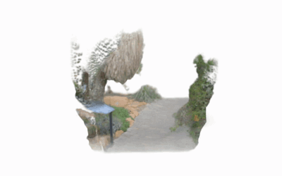
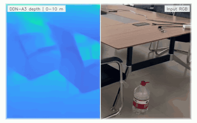
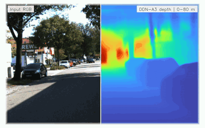
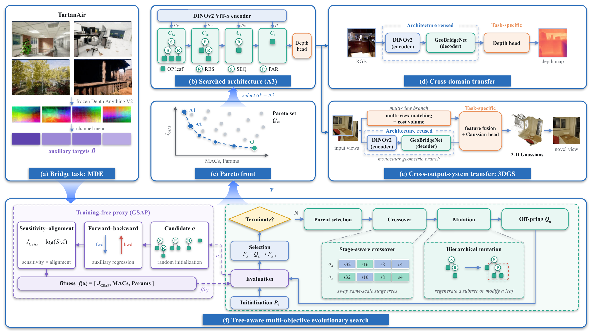
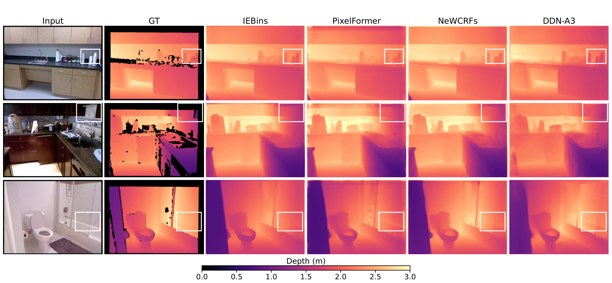
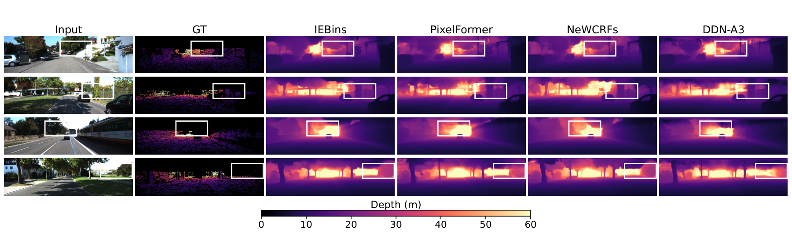
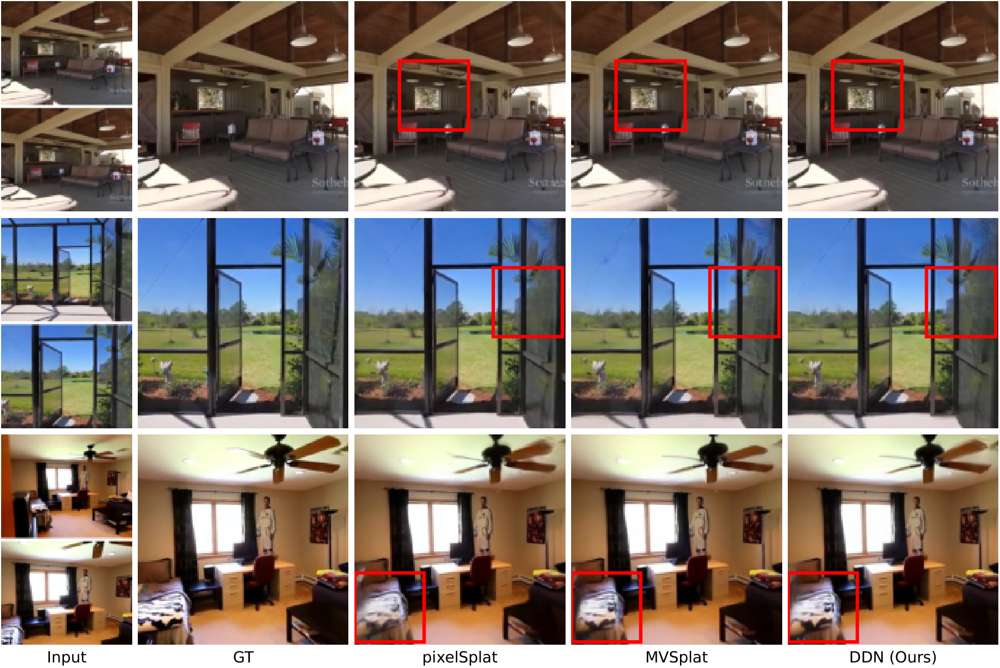
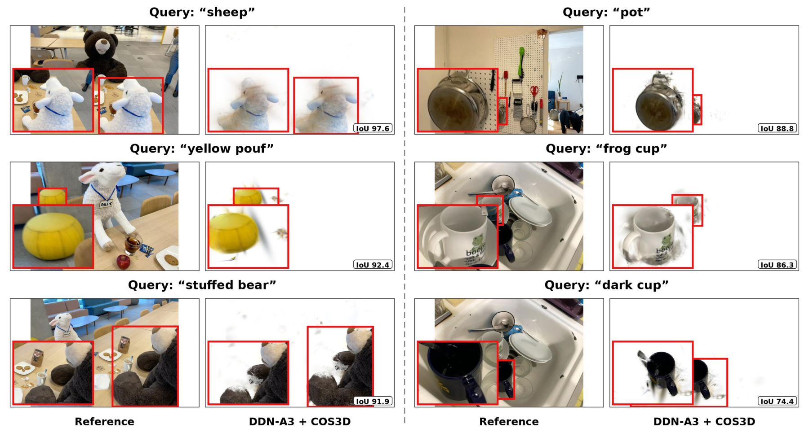

<p align="center">
  <a href="https://github.com/EMI-Group/evox">
    <picture>
      <source media="(prefers-color-scheme: dark)" srcset="assets/evox_brand_light.svg">
      <source media="(prefers-color-scheme: light)" srcset="assets/evox_brand_dark.svg">
      
    </picture>
  </a>
</p>

<div align="center">

# GeoBridge: Evolving Transferable Decoder Topologies for Geometric Vision

**Rui Wang<sup>1</sup> · Haoyu Zhang<sup>1</sup> · Ran Cheng<sup>2</sup>**  
<sup>1</sup>Hangzhou Normal University · <sup>2</sup>The Hong Kong Polytechnic University

**Evolve once. Reuse decoder topologies across geometric vision systems.**

<a href="https://arxiv.org/abs/2610.15280"></a>
<a href="https://emi-group.github.io/GeoBridge-NAS/"></a>
<a href="https://huggingface.co/kujimili/GeoBridge-NAS"></a>
<a href="#depth-evaluation"></a>

</div>

<table align="center">
  <tr>
    <td width="50%" align="center" valign="top">
      <a href="docs/assets/demos/hero-nvs.mp4"></a><br>
      <strong>Novel view synthesis</strong><br>
      <sub>Botanical garden · GeoBridgeNet-A3</sub>
    </td>
    <td width="50%" align="center" valign="top">
      <a href="docs/assets/demos/hero-semantics.mp4"></a><br>
      <strong>Open-vocabulary segmentation in 3D</strong><br>
      <sub>Teatime · GeoBridgeNet-A3 + COS3D · “sheep”</sub>
    </td>
  </tr>
  <tr>
    <td width="50%" align="center" valign="top">
      <a href="docs/assets/demos/hero-depth-indoor.mp4"></a><br>
      <strong>Indoor depth estimation</strong><br>
      <sub>Our meeting room · GeoBridgeNet-A3</sub>
    </td>
    <td width="50%" align="center" valign="top">
      <a href="docs/assets/demos/hero-depth-outdoor.mp4"></a><br>
      <strong>Outdoor depth estimation</strong><br>
      <sub>KITTI street · GeoBridgeNet-A3</sub>
    </td>
  </tr>
</table>

<p align="center"><sub>GeoBridgeNet-A3 results · Click an animation for the full-quality video · <a href="#interactive-demos">Explore the 3D scenes</a></sub></p>

<p align="center">
  <a href="#overview">Method</a> ·
  <a href="#main-results">Results</a> ·
  <a href="#environment">Install</a> ·
  <a href="#depth-evaluation">Depth</a> ·
  <a href="#realestate10k">Novel views</a> ·
  <a href="#cos3d">3D segmentation</a> ·
  <a href="#workflow">Train &amp; search</a>
</p>

## Overview

**GeoBridge** is an evolutionary framework for **transferable decoder topologies**. It searches the internal computation of decoder stages within a fixed multi-scale scaffold, then reuses the selected structures in monocular depth estimation and Gaussian novel view synthesis. The reconstructed scenes also support open-vocabulary 3D segmentation through COS3D.

- **Composable topology:** residual, sequential, and parallel operators compose configurable primitives while preserving each stage's input and output interfaces.
- **Evolution without candidate training:** functional trees support stage-aware crossover and hierarchical mutation. NSGA-II balances the gradient sensitivity-alignment proxy (**GSAP**) with computation and parameter cost.
- **Transfer across systems:** one source search on TartanAir produces **GeoBridgeNet-A1, GeoBridgeNet-A2, and GeoBridgeNet-A3**. Each target system retains the selected topology and primitive configurations, and trains its own weights and prediction interface.

<p align="center"></p>

**Naming and compatibility.** GeoBridge is the framework; GeoBridgeNet is the resulting model family. Code and model weights are hosted in the **GeoBridge-NAS** repositories. Earlier releases used **DDN**; the `ddn` Python package and legacy command-line identifiers retain that name for compatibility. In configurations and commands, `A1`, `A2`, and `A3` denote the corresponding GeoBridgeNet variants.

## Main results

Selected main-experiment results from the manuscript. Columns denote the three GeoBridgeNet variants; **bold** marks the best value for each metric.

| Benchmark | Metric | A1 | A2 | A3 |
|:---|:---|---:|---:|---:|
| NYU Depth V2 | AbsRel ↓ | 0.0918 | 0.0895 | **0.0876** |
| KITTI | AbsRel ↓ | 0.0582 | 0.0561 | **0.0555** |
| RealEstate10K | PSNR ↑ | 27.02 | 27.07 | **27.11** |
| LERF · COS3D | mIoU (%) ↑ | **51.06** | 49.77 | 50.54 |
| LERF · COS3D | mAcc (%) ↑ | 70.58 | 67.87 | **71.32** |

LERF uses GeoBridgeNet initializers with COS3D refinement; scores are the unweighted mean over four scenes, with mAcc reported as Acc@0.25.

<details>
<summary><strong>Qualitative comparisons from the manuscript</strong></summary>

**NYU Depth V2**



**KITTI**



**RealEstate10K**



**COS3D**



</details>

## Model weights

Download the public checkpoints from **[🤗 kujimili/GeoBridge-NAS](https://huggingface.co/kujimili/GeoBridge-NAS)**.

```bash
python -m pip install -U huggingface_hub
hf download kujimili/GeoBridge-NAS --local-dir ./weights/public
```

For a single model, add its filename after the repository ID, for example `nyu/a3.pth`.

| Task | Architectures | Checkpoint layout |
|:---|:---|:---|
| NYU / KITTI depth | A1, A2, A3 | `{nyu,kitti}/a{1,2,3}.pth` |
| RealEstate10K novel views | A1, A2, A3 | `re10k/a{1,2,3}.ckpt` |
| COS3D scene grounding | A1, A2, A3 × four scenes | `cos3d/a{1,2,3}/{scene}/` |

COS3D scenes: **Figurines · Teatime · Ramen · Waldo Kitchen**. See the [scene-weight layout](cos3d/README.md).

## Environment

The core environment uses **Python 3.10 · PyTorch 2.6.0 · CUDA 12.4**. Clone the repository, then run commands from its root.

```bash
git clone https://github.com/EMI-Group/GeoBridge-NAS.git
cd GeoBridge-NAS
python -m pip install torch==2.6.0 torchvision==0.21.0 --index-url https://download.pytorch.org/whl/cu124
python -m pip install -r requirements.txt
```

Depth checkpoints include the student encoder, so evaluation needs no initialization download. Training and search use DINOv2 ViT-S initialization via `--dinov2_ckpt`; the encoder downloads it when absent. Use separate environments for [NVS](#realestate10k) and [COS3D](#cos3d).

## Depth evaluation

Choose a genotype from `configs/architectures.json` and its matching checkpoint. The dataset split files contain relative image/depth paths.

```bash
export WEIGHTS="$PWD/weights/public"
export NYU_ROOT=/path/to/nyu
export KITTI_ROOT=/path/to/kitti
ARCH=$(python -c 'import json; print(json.load(open("configs/architectures.json"))["A3"])')

# NYU Depth V2
python scripts/evaluate_depth.py \
  --ckpt "$WEIGHTS/nyu/a3.pth" --arch "$ARCH" \
  --dataset nyu --data_root "$NYU_ROOT" --post_process_eval \
  --filenames_file_eval splits/nyu/nyudepthv2_test_files_with_gt.txt

# KITTI
python scripts/evaluate_depth.py \
  --ckpt "$WEIGHTS/kitti/a3.pth" --arch "$ARCH" \
  --dataset kitti --data_root "$KITTI_ROOT" \
  --gt_root "$KITTI_ROOT/data_depth_annotated" \
  --filenames_file_eval splits/kitti/kitti_eigen_test.txt
```

For A1/A2, change **both** the architecture key and checkpoint filename. Parameters load strictly. Add `--output metrics.json` to save results and protocol; FP32 is the default, and `--amp` enables CUDA float16 autocast.

<details>
<summary>Depth evaluation protocol</summary>

| Setting | NYU Depth V2 | KITTI |
|:---|:---|:---|
| Input height × width | 480 × 640 | 352 × 1216, KB crop |
| Depth scale | 1000 | 256 |
| Maximum depth | 10 m | 80 m |
| Evaluation crop | No additional spatial crop | Garg crop |
| Post-processing | Horizontal-flip post-processing | Horizontal-flip post-processing |

</details>

## RealEstate10K

In a separate NVS environment, install the core dependencies above, then add DepthSplat dependencies and evaluate:

```bash
python -m pip install -r third_party/depthsplat/requirements.txt
python scripts/run_re10k.py --mode eval --variant A3 \
  --data-root /path/to/re10k \
  --checkpoint "$WEIGHTS/re10k/a3.ckpt" --output-dir outputs/re10k_a3
```

Use the preprocessed **DepthSplat/MVSplat chunk format**. Evaluation uses the bundled `evaluation_index_re10k.json` and a default chunk interval of **10**, matching the released evaluation setup. Set `--test-chunk-interval 1` to evaluate all available indexed chunks.

<details>
<summary>Novel-view training and depth pretraining</summary>

`run_re10k.py --mode train` additionally requires `--student-checkpoint` and `--gmflow-checkpoint`. Set the training budget with `--batch-size`, `--accumulate` and `--steps`.

The main pretraining pipeline uses `scripts/train_re10k_depth.py`, `scripts/prepare_pseudo_depth.py`, `scripts/prepare_multiview_depth.py` and `scripts/pretrain_student.py` for monocular pretraining and pseudo-depth preparation.

</details>

## COS3D

The Gaussian reconstruction system with a GeoBridgeNet decoder initializes the scene, and COS3D refines its RGB and semantic representation. The public bundle includes **A1/A2/A3 for all four LERF scenes**.

Follow the **[COS3D guide](cos3d/README.md)** for its separate environment, scene preparation, RGB refinement, text grounding, rendering and evaluation.

## Interactive demos

The [project page](https://emi-group.github.io/GeoBridge-NAS/) pairs two novel-view reconstructions and two semantic Gaussian scenes. Rotate, pan and zoom each scene independently; semantic viewers start with **Original scene** and offer text-query highlighting and object isolation.

To preview the page locally, run from the repository root:

```bash
python -m http.server 8000 --directory docs
```

Open **http://localhost:8000** in a browser. The viewer and scene assets are bundled locally. Text controls select saved query predictions; all Gaussians belonging to those predicted objects are retained, with sampled backgrounds for web display.

Full videos: [Meeting room](docs/assets/demos/depth-meeting_room.mp4) · [Living room depth](docs/assets/demos/depth-living_room.mp4) · [Living room novel views](docs/assets/demos/nvs-0.mp4) · [Garden novel views](docs/assets/demos/nvs-1.mp4).

## Workflow

Released-model evaluation can start directly from the commands above. To reproduce the pipeline from decoder search, follow this order:

| Step | Stage | Entry point |
|:---:|:---|:---|
| 1 | Prepare search splits | `scripts/prepare_splits.py` |
| 2 | Cache pretrained teacher features | `scripts/cache_features.py` |
| 3 | Search decoder architectures | `scripts/search.py` |
| 4 | Train the selected depth model | `scripts/train_depth.py` |
| 5 | Evaluate NYU / KITTI | `scripts/evaluate_depth.py` |
| 6 | Transfer to novel view synthesis | `scripts/run_re10k.py` |
| 7 | Refine and ground scene Gaussians | [COS3D guide](cos3d/README.md) |

## Training

<details>
<summary><strong>Retrain a selected depth architecture</strong></summary>

For example, retrain A3 on NYU using the variables from [depth evaluation](#depth-evaluation):

```bash
python scripts/train_depth.py --arch "$ARCH" \
  --dataset nyu --data_root "$NYU_ROOT" --post_process_eval \
  --filenames_file splits/nyu/nyudepthv2_train_files_with_gt_dense.txt \
  --filenames_file_eval splits/nyu/nyudepthv2_test_files_with_gt.txt \
  --dinov2_ckpt /path/to/dinov2_vits14_pretrain.pth \
  --epochs 50 --batch_size 8 --seed 42 --lambda_distill 0 \
  --output_dir outputs/nyu_a3
```

Use `python -m torch.distributed.run --nproc_per_node=N` in place of `python` for distributed training. `--batch_size` is per GPU; `--accum_steps` controls gradient accumulation. Live teacher distillation requires `--boundary_ckpt`, `--scale_ckpt` and a positive `--lambda_distill`.

</details>

## Architecture search

<details>
<summary><strong>Prepare features and search decoder topologies</strong></summary>

```bash
python scripts/prepare_splits.py --root /path/to/tartanair
python scripts/cache_features.py --data_root /path/to/tartanair \
  --scale_ckpt /path/to/scale_teacher_best.pth \
  --boundary_ckpt /path/to/depth_anything_v2_vitl.pth \
  --cache_dir /path/to/feature_cache

python scripts/search.py --cache_dir /path/to/feature_cache \
  --dinov2_ckpt /path/to/dinov2_vits14_pretrain.pth \
  --output_dir outputs/search --pop_size 64 --n_generations 100 \
  --grad_batch_size 8 --seed 42
```

The command above and the search defaults use **64 individuals and 100 generations**, matching the population size and generation budget in the manuscript.

Search minimizes GSAP, MACs and decoder parameter count. The selected GeoBridgeNet-A1/A2/A3 tree architectures are stored under `A1`, `A2`, and `A3` in `configs/architectures.json`; each downstream task has separately trained weights.

</details>

## Efficiency measurements

<details>
<summary><strong>Measure depth and novel-view inference cost</strong></summary>

Main-table latency uses **batch size 1 and FP32**. Compare absolute timings on the paper's GPU model; latency varies across hardware.

```bash
python scripts/benchmark_depth.py --resolution all --batch_sizes 1 --scope full \
  --save_json outputs/depth_latency.json

# Run in the NVS environment.
python scripts/benchmark_re10k.py --data-root /path/to/re10k \
  --checkpoint "DDN-A1=$WEIGHTS/re10k/a1.ckpt" \
  --checkpoint "DDN-A2=$WEIGHTS/re10k/a2.ckpt" \
  --checkpoint "DDN-A3=$WEIGHTS/re10k/a3.ckpt" \
  --precision fp32 --output-dir outputs/re10k_latency
```

The NVS benchmark requires all three checkpoints and uses the legacy labels `DDN-A1/A2/A3` for the corresponding GeoBridgeNet variants.

</details>

## Acknowledgements

Our task-transfer pipelines build on DepthSplat and COS3D / Gaussian Splatting. Upstream code retains its original licenses; see [third-party notices](THIRD_PARTY_NOTICES.md).

Demo media: **Rui Wang** (meeting room), **Curtis Adams / Pexels** (living room footage), **Schöps et al. / ETH3D** (novel views, [CC BY-NC-SA 4.0](https://creativecommons.org/licenses/by-nc-sa/4.0/)), **Geiger et al. / KITTI** (outdoor depth, [CC BY-NC-SA 3.0](https://creativecommons.org/licenses/by-nc-sa/3.0/)), and **Kerr et al. / LERF** (semantic scenes). See [media credits](docs/assets/CREDITS.md) for sources, attribution and processing details.

The presentation is inspired by [MonST3R](https://monst3r-project.github.io/), [Shape of Motion](https://shape-of-motion.github.io/) and [HunyuanWorld-Mirror](https://github.com/Tencent-Hunyuan/HunyuanWorld-Mirror).
